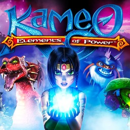

<p align=center></p>

<h1 align=center>Kameo: Elements of Power — Nintendo Switch port</h1>

<p align=center><b>kameo-nx 1.0.1</b> · <a href="https://chanseyisthebest.github.io/kameo-nx-installer/">web installer</a> · <a href="https://github.com/ChanseyIsTheBest/kameo-nx/releases/tag/v1.0.1">release</a></p>

An unofficial native port of the Xbox 360 version of **Kameo: Elements of Power** (Rare, 2005), title update 2, made by
static recompilation with [ReXGlue](https://github.com/rexglue/rexglue-sdk). No emulator. There is a PC build too.

This repository contains no game files. You need your own copy of the game: the Xbox 360 disc (NTSC-U or PAL) and title
update 2 for that disc; the DLC packs are optional.

## Playing it on the Switch

1. Open the web installer: **https://chanseyisthebest.github.io/kameo-nx-installer/**
2. Choose your game (the disc image or an extracted folder), then title update 2's package and any DLC packs, and press
   **Create kameo-nx.zip**. It runs in your browser; your game files stay on your computer.
3. Extract `kameo-nx.zip` to the root of your SD card (it makes `switch/kameo-nx/`).
4. In **Sphaira**, find Kameo: Elements of Power, press **X**, choose **Install Forwarder**, set **Address Space** to
   **39-bit**, choose **Create Forwarder**, and start the game from the Home Screen.

Features:

- Four CPU cores from the second start (through the forwarder).
- Settings in `switch/kameo-nx/kameo.toml`. For a bug report, remove the `#` in front of `log_level = "info"` there and
  send the `switch/kameo-nx/logs/` folder.

## Building

Tools and order: [docs/building.md](docs/building.md). With the game extracted to `D:\kameo\game`
(`tools/extract_iso.py`) and the update's `default.xexp` next to its `default.xex` (`tools/stfs_extract.py`):

```powershell
# Code generation
tools\codegen.ps1
# PC build
tools\build_pc.bat
# The Switch shaders
powershell -NoProfile -ExecutionPolicy Bypass -File tools/switch_shaders.ps1
# Switch build
tools\build_switch.bat
```

Status, findings and decisions: [docs/kameo-notes.md](docs/kameo-notes.md). Progress log:
[docs/progress-log.md](docs/progress-log.md). What goes on the SD card: [dist/switch/README.txt](dist/switch/README.txt).
The release NRO holds the recompiled program, its icon and the shaders no level or model file holds; none of the game's
levels, models, textures, sound or video.

## Credits and license

- **reNut's renderer** by masterspike52: the Direct3D-level renderer (its author permits its reuse in these ports).
- **Kameo: RePowered** by MaxDeadBear and BiRabittoh (MIT): the code generation findings this port starts from, parts of
  its native renderer, and every part marked as theirs in the sources and in the notes. Its MIT notice is in
  [THIRD_PARTY_NOTICES.md](THIRD_PARTY_NOTICES.md).
- **katamari-nx**, **banjo-nx**, **sa2-nx**: the base of this port, its CPU passes, its deko3d work, input.
- **NetherSX2_nx** by NaGaa95 (four-core layout, MIT), **battd_nx** (the GPU arena), **bejeweled3-nx** and the **zuma**
  ports (the hot-function method, version 0x0E shader containers).

GPL-3.0 where the sources are (see [LICENSE](LICENSE)).
